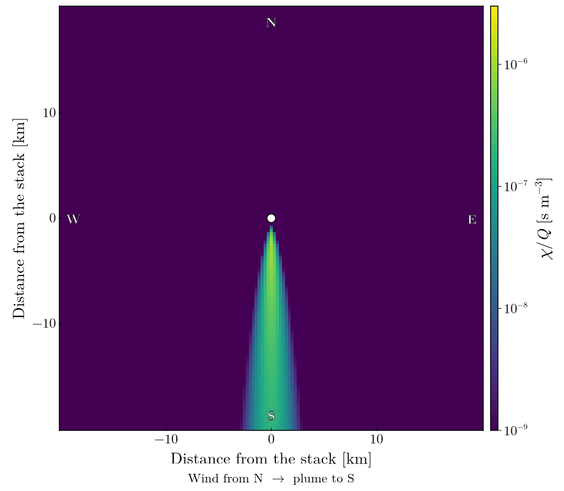
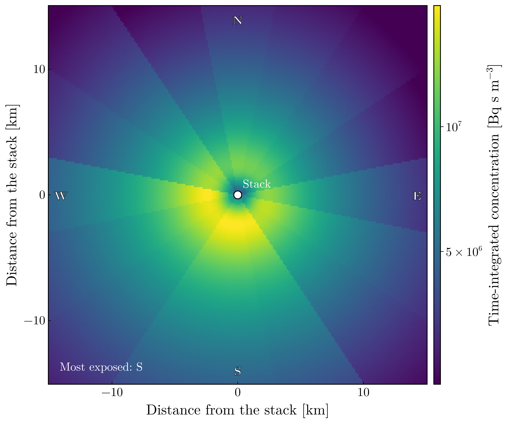
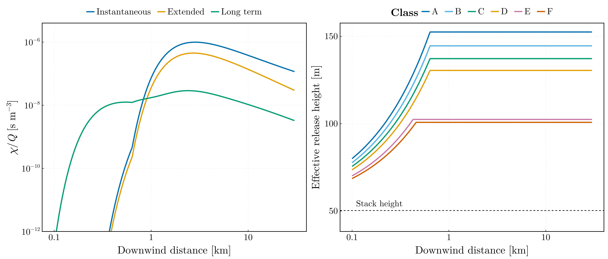
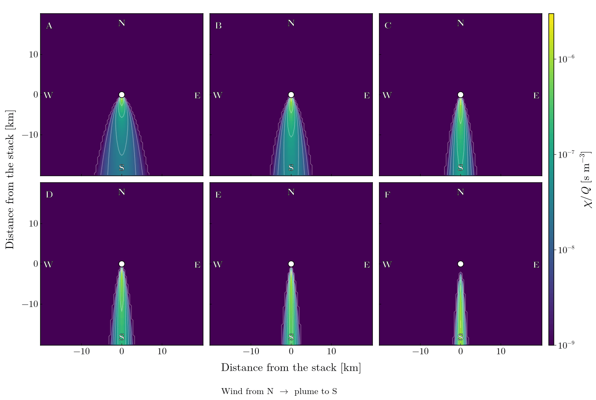
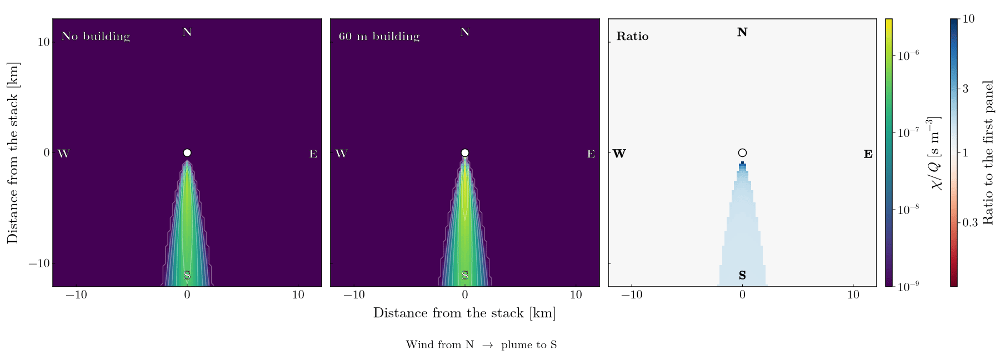
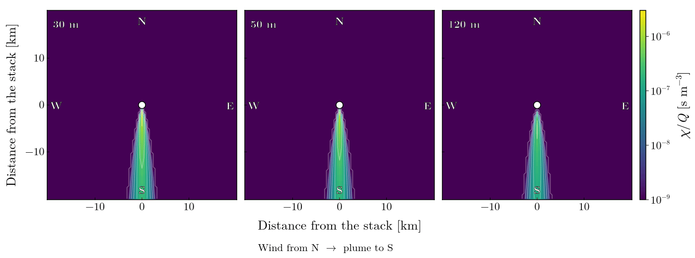
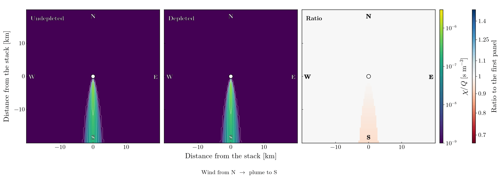
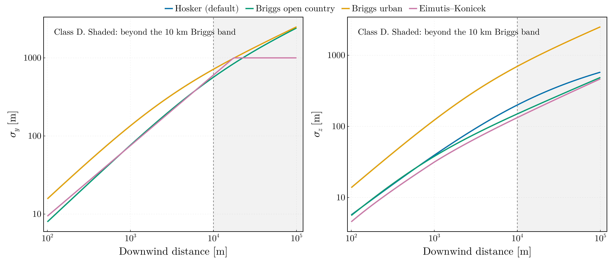

# AtmosphericDispersion.jl

[](https://PaulGoG.github.io/AtmosphericDispersion.jl/stable/)
[](https://github.com/PaulGoG/AtmosphericDispersion.jl/actions/workflows/CI.yml?query=branch%3Amain)
[](https://codecov.io/gh/PaulGoG/AtmosphericDispersion.jl)
[](https://github.com/JuliaTesting/Aqua.jl)
[](https://github.com/aviatesk/JET.jl)
[](https://github.com/SciML/SciMLStyle)
[](https://github.com/PaulGoG/AtmosphericDispersion.jl/actions/workflows/Format.yml?query=branch%3Amain)
[](https://julialang.org/downloads/)

`julia` `julia-package` `computational-physics` `scientific-computing` `physics-simulation` `research-software` `atmospheric-dispersion` `radiological-assessment`

Gaussian-plume atmospheric dispersion of radioactive stack releases: dilution
factor, time-integrated air concentration, dry and wet ground deposition, and
resuspension, over Pasquill–Gifford stability classes and a wind rose. It
provides four published dispersion schemes with the distance range each was
fitted over, Briggs plume rise, a mixing layer, and the building wake and
cavity of IAEA SRS-19. A run is described by one TOML file, and the test suite
checks each parameterisation against its published source.



The ground-level plume as the wind direction sweeps the compass, class D. The
bearing is the direction the wind blows *from*, as in an ADMS `.met` file, so
the plume always lies on the far side of the stack: a northerly puts it south.
The long-term field below is the average of these over a year, weighted by how
often the wind blows *towards* each sector. The 2021 code read that weighting
the wrong way round, which turned every map it produced by a half turn.

The solver core (plume rise, dispersion parameters, building wake, deposition
and resuspension) is nuclide-agnostic. Tritium (HTO/HT) release from a CANDU
stack is a parameterisation of it, and is the case the original work addressed.

## Layout

```
.
├── Project.toml, activate.jl   package manifest; activates the root environment
├── config/reference.toml       annotated run configuration, the CANDU tritium case
├── src/                        the solver, one file per physical component
├── scripts/                    run.jl for a configured run, figures.jl, validation.jl
├── test/                       unit, physics, literature and regulatory validation; Aqua, JET
├── docs/                       Documenter manual
└── figures/                    README figures and validation/, regenerated by scripts/
```

The full tree is [further down](#full-tree).

## Installation

Julia 1.10 or later. The package is not registered; install it by URL:

```julia
using Pkg
Pkg.add(url = "https://github.com/PaulGoG/AtmosphericDispersion.jl")
```

In a checkout, each environment has an activation script that activates and
instantiates it, and every runnable script includes the one it needs as its
first statement, so `--project` is never needed. The first run of each
environment is slow while it precompiles.

```bash
julia -i activate.jl         # REPL in the root environment
julia -i test/activate.jl    # REPL in the test environment
```

## Entry points

```bash
julia scripts/run.jl config/reference.toml                                # long-term field for a run
julia -e 'include("test/activate.jl"); include("test/runtests.jl")'       # test suite and static QA
julia scripts/figures.jl                                                  # regenerate the README figures
julia scripts/validation.jl                                               # regenerate the validation figures
julia docs/make.jl                                                        # build the manual
julia -e 'using JuliaFormatter; format(".")'                              # apply the committed style; needs JuliaFormatter in the default environment
```

## Configuration

A run is described by a TOML file.
[`config/reference.toml`](config/reference.toml) is the annotated template:
ten tables, each key with its unit and bounds in a one-line comment. The
loader checks presence, type, enumerated choice and numerical bound, rejects
keys it does not read, and reports the offending key by its full dotted path:

```
ConfigurationError at `grid.spacing`: must be smaller than grid.extent (20000.0 m), got 20000.0
```

Where published schemes disagree, the choice is a configuration key:

| Key | Choices | Default |
|---|---|---|
| `model.dispersion` | `hosker`, `briggs_open_country`, `briggs_urban`, `eimutis_konicek` | `hosker` |
| `model.extrapolation` | `warn`, `refuse`, `allow`, for a receptor grid outside the scheme's fitted range | `warn` |
| `model.plume_rise` | `briggs`, `xoqdoq`, `nsr23`, the constants the schemes disagree on | `briggs` |
| `model.stable_rise_wind` | `mean_over_rise`, `release_height`, the wind of the stable final rise | `mean_over_rise` |
| `model.resuspension` | `iaea_ss57`, `maxwell_anspaugh` | `iaea_ss57` |
| `model.washout` | `normative`, `hto`, the latter Ogram's snow scavenging of tritiated water | `normative` |
| `mixing_layer.scheme` | `tabulated`, `uniform`, `custom`, `unbounded` | `tabulated` |
| `mixing_layer.above_lid` | `rise_inhibited`, `full_penetration` | `rise_inhibited` |
| `wind_rose.convention` | `blowing_from`, `blowing_toward` | none: it must be stated |

The loader compares the receptor grid with the range the dispersion scheme was
fitted over. The reference grid reaches 20 km, twice the upper limit of the
default scheme, and its configuration sets `allow`; under `warn` the loader
reports

```
Warning: the receptor grid extrapolates DISPERSION_HOSKER past its stated validity range of 100.0–10000.0 m: grid.extent = 20000.0 m lies beyond its 10000.0 m upper end. Set model.extrapolation = "allow" to accept this silently
```

and under `refuse` it throws a `ConfigurationError` at `grid.extent` with the
same text. The [configuration page](docs/src/api/configuration.md) of the
manual describes each choice.

## What it produces



The long-term field for the reference configuration: tritium as HTO, 6.8 × 10¹⁴
Bq over a year, on a 30 × 30 km grid. The sixteen-fold structure comes from the
wind rose: the frequency of transport differs between sectors, so the field is
not circular. The southward bias reflects a rose that peaks on winds *from* the
north. Reading the convention the other way reflects this map through the
origin and places the highest doses on the wrong side of the site.



Left: the three dilution regimes along the plume axis. The instantaneous and
extended forms agree closely near the axis, since the sector average is the
crosswind integral of the three-dimensional field spread over the arc. The
long-term field is flatter because it is averaged over all wind directions. All
three vanish in the near field, where an elevated plume has not yet
reached the ground.

Right: the effective release height by stability class. Plume rise lifts the
50.3 m stack to between 101 and 153 m and saturates within 0.7 km. In
classes A to D the rise takes the neutral limit, which varies as 1/u, so it is
highest in class A, where the wind at stack height is weakest; in the stable
classes E and F the stable limit of the reference inversion holds it near
100 m. The stable final rise is evaluated with the wind averaged over the depth
of the rise, as the Handbook on Atmospheric Diffusion defines it: in class F
that mean is 8.94 m/s against 7.63 m/s at the stack top, which lowers the
effective height by 2.7 m relative to the release-height convention.

### What the parameters do

The figures below are four sweeps of the same release, each varying one
parameter. All panels of a figure share one colour scale.

Half-decade contours are drawn over each field, since a continuous colour ramp
across three decades shows only the largest changes, whereas the displacement
of a contour can be read off directly. The paired comparisons have a third
panel with the ratio of the two fields on a diverging scale centred on one, so
that the colour bar reads as a factor.



**Stability.** The stability class has the largest effect on where the release
reaches the ground. In class A the plume is wide and dilute, with its
ground-level maximum 0.5 km from the stack; in class F it is narrow and does
not peak until 15 km. The peak values differ by a factor of 1.6, but their
distances differ by a factor of 30. At a fixed receptor the classes
differ far more: at 20 km they span a factor of 37, and at 1 km class F is
twelve orders of magnitude below class B, because the plume has not yet reached
the ground. An assessment therefore needs the joint frequency of direction and
class. Class F is also the only class the mixing lid affects in this case: its
plume rises to 100.8 m under a 100 m lid, is held at the lid, and gives about
twice the ground-level value of an unbounded plume from 5 km outwards.



**Building wake, worst case.** A 60 m building stands 25 m from a 50.3 m stack.
The wake criterion is a threshold: a release above two and a half building
heights is unaffected, and one below the building top is entrained into the
aerodynamic cavity and released at ground level. The stack here is lower than
the building, so the release height drops from 50.3 m to zero; plume rise is
still added to it, as NSR-23 prescribes, and in class D carries the plume to
120 m. The third panel shows the ratio of the two fields, on a scale that
saturates at ten: a factor of 7 on the axis at 1 km, 2.1 at 2 km and 1.5 at the
12 km edge of the map.



**Release height.** Raising the stack moves the ground-level maximum downwind
and lowers it. In class D the maximum is 1.33 × 10⁻⁶ s m⁻³ at 2.6 km from a
30 m stack, 9.92 × 10⁻⁷ at 2.8 km from the 50.3 m reference stack, and
3.71 × 10⁻⁷ at 4.6 km from 120 m: a stack four times as high gives a peak 3.6
times lower. Plume rise narrows the difference, since the effective heights
are 121, 130 and 184 m.



**Depletion.** The same plume with and without radioactive decay, dry deposition
and washout by rain throughout the release. For HTO the loss is modest over
this range (the decay constant is 1.78 × 10⁻⁹ s⁻¹ and the deposition velocity
4 mm/s), but it accumulates with distance, since rain and deposition act for
the travel time, and the factors compose by multiplication: 0.2 % at 1 km and
7 % at 20 km, of which the rain is 3.3 %. The difference is
visible only in the ratio panel, since two fields a few per cent apart cannot
be told apart on a colour scale spanning three decades.

Regenerate all of them with `julia scripts/figures.jl`.

## Validation

The test suite first checks the analytic properties of the Gaussian plume,
which are the most sensitive to an error in a normalisation, a reflection term
or a sector width: the crosswind integral, mass conservation across a downwind
plane, the sector average as the crosswind integral over the arc, and the
position of the ground-level maximum. Each parameterisation is then compared
with its published source, coefficient by coefficient: Briggs' σ_y and σ_z,
Hosker's σ_z with its 24 shape and 24 roughness coefficients, the
Eimutis–Konicek fit against the XOQDOQ and PAVAN listings, Briggs' plume rise,
the washout and resuspension constants, and the long-term sector constant of
Regulatory Guide 1.111 and of SRS-19. This comparison found two wrong
coefficients in the roughness table of the Romanian normative, which the 2021
code had copied; the package uses Hosker's values.

Four published calculations are then run through the package end to end:

| Benchmark | What it exercises | Result |
|---|---|---|
| HPA-RPD-058 Table 3.7 | plume depletion by dry deposition: 3 release heights × 6 categories × 8 distances to 100 km | 143 of 144 cells within 0.028 of a table printed to 0.01; the exception is a depletion factor that rises with distance in the source |
| Turner (1970) Table 7-4 | the concentration profile with height at 1 km, both reflection terms | all 16 rows within 2.3 %, Turner's three-figure rounding |
| IAEA SRS-19 Tables I and II, Annex IV | the sector-averaged and the wake-corrected diffusion factors to one figure, and three worked examples on the building zones and cavity | 77 of 77 and 106 of 110 cells to the printed figure, the four others on a rounding boundary; the three examples are reproduced |
| NRC XOQDOQ Test Case 2 | the code's own continuous elevated release: a momentum jet over rising terrain, five wind classes, five stability classes | all 22 printed χ/Q within 0.05 %, the rounding of the four printed figures |



The figure compares the four dispersion schemes in class D over pasture.
Hosker, Briggs open country and Eimutis–Konicek agree in σ_y and differ by up
to a third in σ_z; Briggs' urban set is three times wider vertically at 2 km.
The shaded region lies beyond the 10 km limit of the three Briggs-based schemes
and inside the 100 km limit of Eimutis–Konicek. The Handbook on Atmospheric
Diffusion misprints the urban E–F σ_z coefficient as 0.00015; Briggs' own
report and EPA ISC3 have 0.0015, which the package uses.

`figures/validation/` holds one figure per parameterisation, each drawn against
its published form. Where the test suite asserts an identity the curves
coincide; where it asserts only a bracket, the figure shows the width of the
bracket.

| Figure | Against |
|---|---|
| `dispersion_parameters.png` | Briggs (1973) σ_y and σ_z, all six classes |
| `dispersion_schemes.png` | the four schemes for class D (Hosker, Briggs open country and urban, Eimutis–Konicek) across their validity ranges |
| `roughness_correction.png` | the published `(z₀/0.1)^0.2` scaling |
| `washout.png` | NRPB-R322 and AVV amplitudes, and the `J^0.75` law |
| `resuspension.png` | IAEA Safety Series 57, and its 2011 successor |
| `plume_rise.png` | Briggs final rise and the two-thirds law |
| `ground_level_maximum.png` | the peak and its position, class by class |

Regenerate with `julia scripts/validation.jl`.

## Documentation

The derivations and the evidence are in the documentation, under `docs/src/`:

- [Conventions](docs/src/conventions.md): the wind-direction convention and the effect of misreading it; why depletion factors multiply.
- [Validation](docs/src/validation.md): every parameterisation against its published source, the four end-to-end benchmarks, the mixing layer, and where published schemes disagree.
- [The 2021 thesis code](docs/src/thesis.md): what the rewrite changed and how far the original results move.
- [Known limitations](docs/src/limitations.md): what an independent review found and the size of each effect.
- API reference: `docs/src/api/`.
- [References](docs/src/references.md): every source cited, by DOI where one exists; the list itself is rendered in the built documentation from `docs/src/refs.bib`.

Build it locally with `julia docs/make.jl`.

## Status

The package is feature-complete and in maintenance mode. I fix bugs, correct
anything that disagrees with its published source, and keep it working on new
Julia releases and dependency versions, but I do not plan new features. Reports
of either kind are welcome as issues. The public interface is stable from 1.0.0
and follows semantic versioning.

What each component follows:

| Component | Follows |
|---|---|
| Sector geometry and wind rose | sectors centred on the cardinal directions; the direction convention is a required argument |
| Dispersion parameters | Briggs (1973) open country and urban; Hosker (1974) with the roughness correction, the normative's default; Eimutis and Konicek (1972), limited to 1000 m as in XOQDOQ; each with the range it was fitted over |
| Plume rise | Briggs, momentum and buoyancy; the stable limits in the stable classes E and F, with the final rise on the mean wind over the rise; the wind held at 1 m/s from below; the XOQDOQ and NSR-23 constants selectable |
| Buildings | the tallest building near the stack; the displacement, wake and cavity zones of SRS-19 §3.3; wake broadening with the SRS-19 and AVV coefficient, limited to √3 for a release at ground level with no plume rise, as in XOQDOQ; the two cavity forms of §3.6 |
| Mixing layer | the image sum of HPA-RPD-058 §3.2.2.1 to double precision, its Table 3.5(a) depths; a plume above the lid held at it (NRPB-R157) or leaving the layer (EPA ISC3) |
| Dilution | instantaneous, sector-averaged with the constant of RG 1.111 or SRS-19, and long term over the rose |
| Depletion and deposition | decay, dry deposition, NSR-23 Table 7 washout with Slinn's J^0.75 law and Ogram's snow scavenging of HTO, acting for the travel time on the share of the release in the precipitation; dry and wet deposition, the wet deposit the largest that share can lay at each receptor; Safety Series 57 or Maxwell–Anspaugh resuspension |
| `Site` and `PrescribedPlume` | the per-run precomputation, and a plume whose height, wind or σ a published benchmark states |
| Quality | Aqua, ExplicitImports and, on the current Julia, JET in the suite; 7099 assertions; CI on the LTS and the current Julia, rerun monthly without a commit; the manual built with its doctests |

Outside the scope of the package:

- Stability category G. Briggs (1973) and Hosker (1974) define σ for classes A
  to F only, and XOQDOQ forms its G from the F and E curves (`σ_F²/σ_E`) rather
  than from data.
- The Prairie Grass crosswind-integrated concentrations as a benchmark. The
  roughness length of the site is disputed between 0.006 and 0.03 m and enters
  directly through Hosker's correction, so the comparison would test the choice
  of z₀ more than the model.
- Fumigation of a plume that has risen above the lid. It depends on how the
  mixed layer grows into the plume over time, which a steady-state Gaussian
  plume does not describe, and neither lid rule models it.

The wind rose of the reference case is not a verified measured rose. As far as
I recall, its frequencies are either placeholder values or meteorological data
for the Pitești fuel plant or the Cernavodă NPP site, and in 2021 I read them
under the wrong direction convention. The convention is corrected in the
reference configuration; the frequencies themselves are illustrative.

## Known limitations

A review of the physics against the literature in November 2026 led to the
corrections of 1.1.0, listed in the [changelog](CHANGELOG.md). The points below
remain; the [limitations page](docs/src/limitations.md) of the manual gives
the numbers.

- Dry deposition takes the high deposition velocity, on air depleted with the
  low velocity and the low washout coefficient, so the ground receives up to
  twice what dry deposition takes from the plume, and with precipitation the
  two deposits together can exceed what the plume loses. Wet deposition is
  the largest deposit the precipitation can lay at each receptor, whenever it
  falls, so summed over the ground it exceeds the share released into it
  beyond `u/Λ`.
- Washout of the airborne plume assumes the precipitation lasts much longer
  than the travel time; for a shorter one the result depends on when it
  falls, and the loader warns.
- A deposition velocity above zero for HTO lowers the air concentration; with
  re-emission, zero is the conservative choice (Lee et al. 2012,
  doi:10.2172/1038895).
- The building rules of the normative: a release entrained into the cavity is
  released at ground level and still receives the full plume rise, and the
  entrainment test is discontinuous at its 5 m/s threshold. The √3 limit of a
  ground-level release no longer applies once the plume rises at all, so near
  the building the concentration drops between no efflux and the smallest.
- The stable classes E and F share one temperature gradient.

## Full tree

<details>
<summary>Every tracked file</summary>

```
.
├── Project.toml            package manifest and [compat]
├── activate.jl             activates and instantiates the root environment
├── CHANGELOG.md            what changed, release by release
├── CITATION.cff            citation metadata, rendered by GitHub
├── LICENSE                 MIT
├── .JuliaFormatter.toml    the committed formatting style, SciMLStyle
├── .gitattributes, .gitignore
├── config/
│   └── reference.toml      the CANDU tritium case, with bounds in the comments
├── figures/
│   ├── *.png, *.gif        the README figures and animations, from scripts/figures.jl
│   └── validation/         one figure per parameterisation, from scripts/validation.jl
├── scripts/
│   ├── Project.toml        plotting environment, kept out of the package
│   ├── activate.jl
│   ├── theme_common.jl     figure style shared by the scripts below
│   ├── run.jl              long-term field for a configured run
│   ├── figures.jl          the figures above
│   └── validation.jl       every parameterisation against its published form
├── src/
│   ├── AtmosphericDispersion.jl   module, includes and exports
│   ├── sectors.jl          wind-rose sector geometry
│   ├── stability.jl        Pasquill–Gifford stability classes
│   ├── windrose.jl         directional and stability joint frequencies
│   ├── surfaces.jl         surface, roughness and precipitation categories
│   ├── tables.jl           tabulated coefficients of the normative
│   ├── mixing.jl           mixing-layer depth and the lid reflections
│   ├── dispersion.jl       wind profile, the four dispersion schemes, validity ranges
│   ├── source.jl           stack, ambient state, fluxes, stability parameter
│   ├── plumerise.jl        momentum and buoyancy rise
│   ├── buildings.jl        building envelope, wake broadening, the SRS-19 zones
│   ├── site.jl             release height and the per-run precomputation
│   ├── dilution.jl         the three dilution regimes and the two cavity forms
│   ├── nuclides.jl         species: decay constant and deposition velocity
│   ├── depletion.jl        decay, dry deposition and washout
│   ├── deposition.jl       ground deposition and resuspension
│   ├── config.jl           TOML loader, validated key by key
│   └── precompile.jl       PrecompileTools workload: a configured run
├── test/
│   ├── Project.toml
│   ├── activate.jl
│   ├── runtests.jl         includes the files below, in dependency order
│   ├── fixtures.jl         the reference stack, atmosphere and site the suite shares
│   ├── test_quality.jl     Aqua, JET, ExplicitImports
│   ├── test_<source>.jl    one file per source file: sectors, stability, windrose,
│   │                       tables, dispersion, source, plumerise, buildings, site,
│   │                       mixing, dilution, depletion, deposition, config
│   ├── test_physics_validation.jl   analytic invariants of the Gaussian plume
│   ├── test_literature.jl  published tables and constants, source by source
│   └── test_regulatory.jl  SRS-19's tables and examples and XOQDOQ's test case, end to end
├── docs/
│   ├── Project.toml
│   ├── activate.jl
│   ├── make.jl             Documenter build
│   └── src/
│       ├── index.md        overview and a worked run
│       ├── conventions.md  the wind-direction convention, and why depletion multiplies
│       ├── validation.md   the analytic invariants and every published comparison
│       ├── thesis.md       the 2021 code, and how far its results move
│       ├── limitations.md  known limitations, with the size of each effect
│       ├── references.md, refs.bib   the bibliography, DOI-keyed
│       └── api/            four API pages
└── .github/                CI and Format workflows, Dependabot configuration
```

</details>

## History

The [`original`](../../tree/original) branch holds the code as submitted for
the BSc thesis at the Faculty of Physics, University of Bucharest, in June 2021,
its files under English names since 2026 with the submitted names mapped in its
README, together with the thesis itself (`BSc_thesis_2021.pdf`, in Romanian).
`main` shares no history with it. On the CANDU case four of the corrections
change the result: the wind-direction convention by a half turn and a factor of
1.51; the stable limits of the plume rise, which the 2021 code applied in every
class, confined to the stable classes, which halves the near field (a factor of
0.48 at 1 km); the mixing layer by up to +23 % at 20 km; and the stable rise on
the mean wind by 1 % at 2 km. The details are in
[docs/src/thesis.md](docs/src/thesis.md), and the changes of each release in
[CHANGELOG.md](CHANGELOG.md).

## How to cite

`CITATION.cff` carries the metadata; GitHub renders it as a citation block.

```bibtex
@software{Gogita_AtmosphericDispersion_jl,
  author  = {Gogîță, Paul-Adrian},
  title   = {AtmosphericDispersion.jl: Gaussian-plume atmospheric dispersion of stack releases},
  year    = {2026},
  version = {1.1.0},
  url     = {https://github.com/PaulGoG/AtmosphericDispersion.jl}
}
```

## Licence

MIT, see `LICENSE`.
